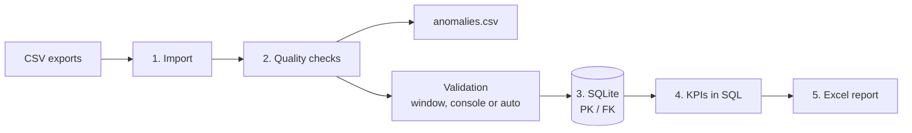
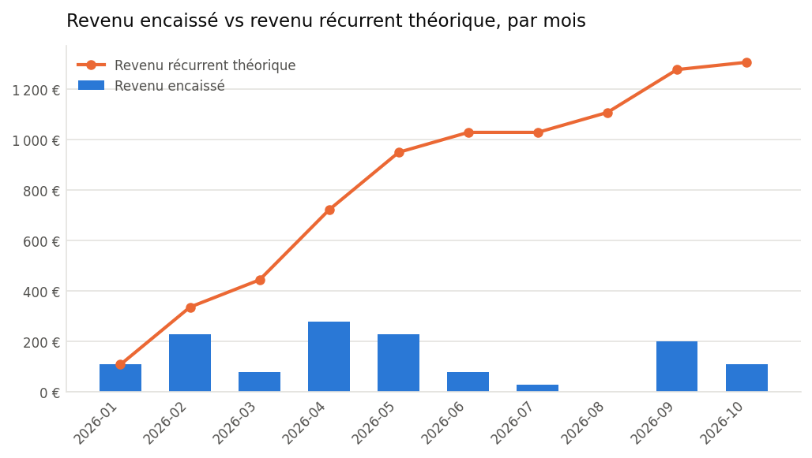
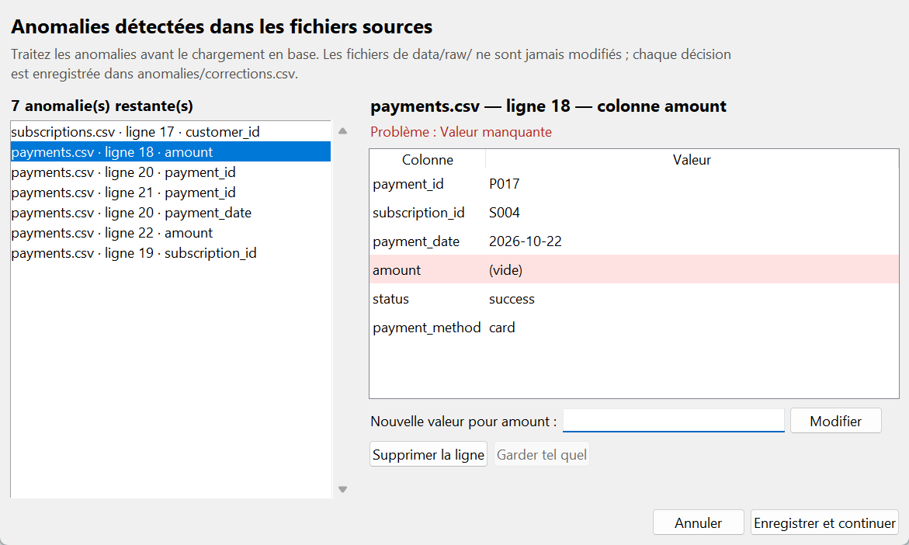

# SalesFlow — Automated Business Reporting

**One command turns raw SaaS sales exports into a clean database, reliable KPIs and a ready-to-share Excel report.**


SalesFlow is an end-to-end data pipeline built for a fictional SaaS startup. It takes three CSV
exports (customers, subscriptions, payments), detects and handles data quality issues, loads the
data into a relational SQLite database, computes the KPIs a founder actually looks at, and
produces a formatted Excel report with charts.

> Portfolio project built with synthetic data. The code, the tests and the engineering choices
> are the same ones I apply to client work.

---

## The problem it solves

In many small companies, monthly reporting is still manual: export CSVs, fix errors by hand in
Excel, recompute the same figures, copy-paste charts. It is slow, error-prone, and data quality
problems are silently ignored.

SalesFlow replaces that routine with a reproducible pipeline:

| Before (manual) | After (SalesFlow) |
|---|---|
| Errors found by chance, or never | Every anomaly listed with its file, line and column |
| Corrections lost at the next export | Corrections journaled and re-applied automatically |
| KPIs recomputed by hand each month | KPIs computed in SQL, always with the same definitions |
| Report rebuilt in Excel | Excel report (5 sheets + charts) generated in under a second |
| A broken file produces a wrong report | The pipeline stops with an explicit error, no partial report |

## How it works



```text
$ python main.py          # output shortened

=== [1/5] Import des fichiers sources ===         -> OK
=== [2/5] Nettoyage et validation ===             -> OK   7 anomalies detected and handled
=== [3/5] Chargement dans SQLite ===              -> OK   15 customers, 15 subscriptions, 16 payments
=== [4/5] Calcul des indicateurs ===              -> OK
=== [5/5] Génération du rapport Excel ===         -> OK

Pipeline terminé en 0.7 s. Rapport : reports/monthly_report.xlsx
```

If a critical step fails, the pipeline stops cleanly and tells you what to do:

```text
ÉCHEC à l'étape 3/5 (Chargement dans SQLite)
  Cause : IntegrityError : FOREIGN KEY constraint failed
  Piste : Vérifier les données nettoyées : python src/validation.py
Pipeline arrêté : les étapes suivantes n'ont pas été lancées et le rapport n'a pas été mis à jour.
```

## The Excel report

`reports/monthly_report.xlsx` — formatted tables (euro and percentage formats, frozen headers,
French labels) and charts generated with matplotlib.

| Sheet | Content |
|---|---|
| **Dashboard** | KPI tiles (cash collected, MRR, active customers, average payment, failure rate, anomalies) and charts |
| **Revenue** | Month by month: cash collected vs. theoretical recurring revenue, and the gap |
| **Customers** | Customer statistics, breakdown by country, full customer list with total paid |
| **Subscriptions** | Breakdown by plan and by status |
| **Data Quality** | Anomalies by file, by type, and full detail with CSV line numbers |

<p align="center">
  
</p>

The chart above makes a business issue visible at a glance: theoretical recurring revenue keeps
growing while cash collected does not follow, which points to missing or failed payments.

## KPIs

All aggregations are written in SQL (`src/analytics.py`); pandas is only used for formatting.

| KPI | Definition |
|---|---|
| Cash collected | Sum of successful payments, assigned to the **payment date** (not the subscription date) |
| Theoretical MRR | Sum of monthly prices of active subscriptions |
| Monthly revenue | Cash collected per month, compared with theoretical recurring revenue per month |
| Active customers | Distinct customers with at least one active subscription |
| Average payment | Mean amount of successful payments |
| Payment failure rate | Failed payments / total payments |
| Subscription mix | Number of subscriptions by plan and by status |

## Data quality

`src/cleaning.py` checks every file and writes `anomalies/anomalies.csv`
(`file_name`, `row_number`, `column_name`, `error_message`), where `row_number` is the exact
line in the original CSV.

| Check | Example |
|---|---|
| Missing values | Payment without an amount |
| Duplicate identifiers | Two payments with the same `payment_id` (every occurrence is reported) |
| Invalid dates | `2026-13-40`, `12/01/2026` |
| Invalid numbers | Non-numeric or negative amounts and prices |
| Invalid emails | `contact@` |
| Inconsistent periods | Subscription ending before it starts |
| Broken references | Subscription for an unknown customer, payment for an unknown subscription |

### Validation window

When anomalies remain, `python main.py` opens a window **before any calculation**: the user
fixes a value, deletes the row or keeps it as is, then clicks *Enregistrer et continuer* and
the pipeline resumes. *Annuler* stops the pipeline without saving anything.
To try it again once the anomalies have been fixed, run `python main.py --demo`: the sample
data is reloaded with all its errors and the corrections journal is ignored (and left untouched).

<p align="center">
  
</p>

The same review is available in the console (`python main.py --interactive` or
`python src/validation.py`):

```text
Anomalie (6 restante(s))
  Fichier : payments.csv   Ligne : 18   Colonne : amount
  Problème : Valeur manquante
  Ligne complète :
    payment_id       P017
    subscription_id  S004
    payment_date     2026-10-22
  > amount           (vide)
    status           success
    payment_method   card
[m] Modifier la valeur  [s] Supprimer la ligne  [q] Quitter
Votre choix :
```

- Each fix is re-checked immediately; an anomaly solved indirectly (e.g. the other half of a
  duplicate) disappears on its own.
- Raw files are never modified: clean data goes to `data/processed/`.
- Every decision is written to `anomalies/corrections.csv` and **re-applied on the next runs**,
  so a correction is made only once, even when new exports arrive.
- *Keep as is* is only offered for anomalies that cannot break the database (e.g. a negative
  amount that is actually a refund).
- Rows that still have unresolved anomalies are excluded from the clean data (together with the
  rows that depend on them) instead of polluting the KPIs. This is also what `--auto` does,
  without any window, for scheduled runs; on a machine without a display, the pipeline
  switches to this mode by itself.

## Getting started

**Requirements:** Python 3.10+

```bash
git clone https://github.com/Grosbinator/SalesFlow---Automated-Business-Reporting.git
cd SalesFlow---Automated-Business-Reporting

python -m venv .venv
.venv\Scripts\activate          # Windows
# source .venv/bin/activate     # macOS / Linux

pip install -r requirements.txt
```

Then run the pipeline. It works right away on the sample data shipped in
[`data/sample/`](data/sample/), which contains intentional errors to show the quality checks:

```bash
python main.py
```

The Excel report is written to `reports/monthly_report.xlsx`.

To process your own exports, point the pipeline to the folder containing `customers.csv`,
`subscriptions.csv` and `payments.csv`:

```bash
python main.py --source path/to/exports
# or once for all runs:
export SALESFLOW_SOURCE_DIR=path/to/exports     # PowerShell: $env:SALESFLOW_SOURCE_DIR="..."
```

| Command | What it does |
|---|---|
| `python main.py` | Full pipeline on the sample data (or on `SALESFLOW_SOURCE_DIR` if set), with the validation window |
| `python main.py --source DIR` | Full pipeline on the CSV files found in `DIR` |
| `python main.py --skip-import` | Full pipeline on the files already in `data/raw/` |
| `python main.py --interactive` | Review anomalies in the console instead of the window |
| `python main.py --auto` | No window, no question: rows with anomalies are excluded (scheduled runs) |
| `python main.py --demo` | Test mode: sample data with all its errors, corrections journal ignored and left untouched |
| `python src/validation.py` | Validation console only |
| `python -m pytest -v` | Run the test suite |

### Input data

| File | Columns |
|---|---|
| `customers.csv` | `customer_id`, `company_name`, `email`, `signup_date`, `country` |
| `subscriptions.csv` | `subscription_id`, `customer_id`, `plan`, `monthly_price`, `start_date`, `end_date` (empty = ongoing), `status` |
| `payments.csv` | `payment_id`, `subscription_id`, `payment_date`, `amount`, `status`, `payment_method` |

## Project structure

```text
.
├── main.py                 # Orchestrates the 5 steps, fail-fast with explicit errors
├── src/
│   ├── import_data.py      # Copies the source CSV files (configurable folder) into data/raw/
│   ├── cleaning.py         # Quality checks -> anomalies/anomalies.csv
│   ├── validation.py       # Validation logic and console -> data/processed/
│   ├── validation_gui.py   # Validation window (tkinter) opened by main.py
│   ├── database.py         # SQLite schema (PK/FK), idempotent loading
│   ├── analytics.py        # KPIs written in SQL
│   └── report.py           # Excel report (openpyxl) and charts (matplotlib)
├── tests/                  # 117 pytest tests, one file per module
├── data/sample/            # Synthetic sample exports, with intentional errors
├── data/raw/               # Imported CSV files (generated)
├── data/processed/         # Clean CSV files (generated)
├── anomalies/              # Data quality report and corrections journal (generated)
├── reports/                # Excel report (generated)
└── requirements.txt
```

## Engineering choices

- **Fail fast, never ship a wrong report.** Each step runs only if the previous one succeeded;
  the Excel file is written to a temporary file and swapped in only when complete.
- **Idempotent loading.** Primary and foreign keys, `INSERT … ON CONFLICT DO UPDATE` (upsert),
  removal of rows that disappeared from the source, all in a single transaction. Running the
  pipeline twice gives exactly the same database.
- **SQL for aggregations, pandas for presentation.** Recursive CTE to generate the months,
  sub-queries to avoid double counting in joins, `NULLIF` to avoid division by zero.
- **Traceability.** Every anomaly points to an exact CSV line; every manual correction is
  journaled with its old and new value.
- **Testable by design.** Database paths are injectable, console input/output can be scripted,
  so every module is tested in isolation and the full pipeline is tested end to end in a
  temporary directory.

## Tests

```bash
python -m pytest -v
```

117 tests cover the source folder selection, the quality checks, the validation console (with simulated keyboard input), the validation window (with simulated clicks),
SQLite loading and referential integrity, KPI calculations on datasets with known results,
the Excel workbook content, and the full pipeline end to end, including the failure cases.
Tests never touch the real files in `data/`.

## Git workflow

`main` is the stable branch. Each module was developed on its own branch (`import_data`,
`cleaning`, `test_cleaning`, `database`, `analytics`, `report`, `validation`, `pipeline`, …)
with small, documented commits, then merged into `main`.

## Roadmap

- Streamlit interface to upload files and download the report
- Configurable validation rules (YAML)
- Support for Excel input files
- Scheduled execution and email delivery of the report
- Docker image

## About

**Robin Philis** — Python automation · Data engineering · SQL · Business intelligence

I build pipelines that clean business data, automate recurring reports and make the numbers
reliable. **Available for freelance missions**: data cleaning and validation, Excel / SQL
reporting automation, KPI dashboards.

---

*SalesFlow uses synthetic data only. It is not affiliated with any real company.*
